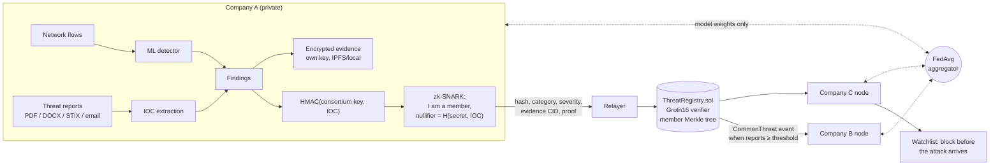

<div align="center">

# Decentralised Threat Detection System

**Companies detect attacks locally with machine learning, share what they saw anonymously, and warn each other before the same attack reaches them.**

[](https://github.com/Vinayak210405/Decentralised-Threat-Detection-System/actions/workflows/ci.yml)


</div>

## The idea

Many companies face the same cyber attacks every day, but they don't share what they see: a breach is embarrassing, reports contain internal details, and nobody wants a competitor reading their logs. So the same attacker hits company after company.

This project lets companies pool threat knowledge **without any of them being able to read the others' data**:

1. **Detect locally.** Each company runs an intrusion-detection model on its own traffic and extracts indicators (IPs, domains, file hashes) from the threat reports it receives. Raw data never leaves the company.
2. **Share anonymously.** For each indicator, the company submits only a *keyed hash* plus a **zero-knowledge proof** that says "a member company saw this", without revealing *which* member.
3. **Warn everyone when it's common.** When enough *independent* companies have reported the same indicator, the smart contract flags it as a common threat and every member blocks it, including members it hasn't hit yet.
4. **Learn together.** Companies can also train a shared detection model with **federated learning**: they exchange model weights, never traffic.

## Results

All numbers below were measured by the code in this repo; the commands to reproduce them are in [Reproduce](#reproduce).

### Intrusion detection (NSL-KDD, official test set)

| Model | Accuracy | Macro-F1 | Detection rate | False alarms | Detection: known attack types | Detection: **novel** attack types |
|---|---|---|---|---|---|---|
| Logistic regression | 76.3% | 58.6% | 70.1% | 9.3% | 81.6% | 42.2% |
| Random forest | 73.5% | 47.5% | 57.2% | 2.6% | 75.3% | 13.4% |
| **Gradient boosting** | **80.1%** | **66.5%** | 70.6% | 2.9% | **84.5%** | 37.0% |
| MLP (128-64) | 77.0% | 62.3% | 64.0% | 3.0% | 80.0% | 25.1% |

The NSL-KDD test set is deliberately hard: 16.6% of its rows are 17 attack types that never appear in training. The best single model catches **84.5% of attack types it was trained on but only 37% of novel ones**. That gap is the case for sharing between companies. Per-class tables and confusion matrices: [`reports/ml/nsl-kdd/results.md`](reports/ml/nsl-kdd/results.md).

### Federated learning across 3 simulated companies (mean ± std over 5 seeds)

Each company sees normal traffic plus **only its own attack types** (A: DoS + probing, B: remote-access attacks, C: privilege escalation), the realistic case:

| | Macro-F1 | Attack detection rate | Recall on attack types the company never saw |
|---|---|---|---|
| Each company alone | 28.1 ± 0.6% | 23.2 ± 0.9% | 0% |
| **Federated (FedAvg, equal weight per company)** | **57.7 ± 2.4%** | **61.7 ± 0.7%** | **47.4 ± 0.7%** |
| Centralised (all data pooled; what privacy forbids) | 59.0 ± 4.4% | n/a | n/a |

Federated training gets within about 1 point of the pooled-data model without any company sharing a single flow. Standard sample-weighted FedAvg reaches 49.7%: the largest company drowns out rare attacks only smaller companies have seen, which equal per-company weighting fixes. Full table (including Dirichlet and IID splits): [`reports/ml/nsl-kdd/federated_summary.md`](reports/ml/nsl-kdd/federated_summary.md).

### End-to-end demo (`python -m dtds.demo`, 22 s)

A real local chain, real Groth16 proofs, the trained detector, and the team's sample threat reports:

* Companies A and B are hit by the same attacker; their detectors flag it and each reports it anonymously. Two independent reports reach the threshold, so the contract emits **CommonThreat**. A port scanner seen by only one company stays below the threshold.
* A and B ingest two *different* threat reports from `samples/reports/`; the two indicators both reports contain become common threats as well.
* Company C, never attacked yet, receives **3 early warnings**. The attacker then hits C with a DoS variant the model was never trained on:

| Company C | Attack flows stopped | Legitimate flows blocked |
|---|---|---|
| Its own ML model alone | 28 / 150 (19%) | n/a |
| **With consortium early warning** | **150 / 150 (100%)** | **0** |

* Privacy check: no plaintext indicator is on-chain, an outsider's guess without the consortium key doesn't match, all 13 reports come from one relayer address, and company B cannot decrypt company A's evidence.
* Company D applies to join; A and B vote anonymously, and D is admitted.

Full transcript: [`docs/demo_output.txt`](docs/demo_output.txt). The 100% is by construction (the attacker reused an IP that was already flagged); see [Limitations](#threat-model-and-limitations) for what happens when attackers rotate infrastructure.

Proof generation takes about 1.5 s per report on a laptop CPU; `submitReport` costs about 310–340k gas.

## Architecture



| Component | Where | What it does |
|---|---|---|
| ML detection | [`dtds/ml/`](dtds/ml) | Dataset loaders (NSL-KDD, UNSW-NB15, CIC-IDS2017), signed-log + scaling + one-hot preprocessing, 4 classifiers, per-class and novel-attack evaluation |
| Federated learning | [`dtds/ml/federated.py`](dtds/ml/federated.py) | FedAvg from scratch, federated feature scaling from aggregated statistics, non-IID partitions, class-balanced local loss |
| Report ingestion | [`dtds/extraction/`](dtds/extraction) | Text from PDF, DOCX, HTML, STIX/JSON, email, XLSX; refanging (`hxxp`, `[.]`), private/documentation IP filtering, benign allowlist, canonical IOC form |
| Keyed IOC hashing | [`dtds/sharing/ioc_hash.py`](dtds/sharing/ioc_hash.py) | HMAC-SHA256 under a consortium key, sized to the SNARK field |
| ZK membership circuit | [`circuits/membership.circom`](circuits/membership.circom) | Poseidon Merkle membership (depth 10, up to 1,024 companies) + nullifier + signal binding; 2,884 constraints |
| Smart contract | [`contracts/ThreatRegistry.sol`](contracts/ThreatRegistry.sol) | On-chain Poseidon member tree, proof verification, distinct-reporter counting, threshold alerts, anonymous governance |
| Company node | [`dtds/node.py`](dtds/node.py) | Detect, extract, hash, prove, submit; sync common threats; block on the watchlist |
| Alerts | [`dtds/alerts.py`](dtds/alerts.py) | Console, JSON-lines, webhook (Slack/Teams/Discord), email |

## How the privacy works

| Question | Answer |
|---|---|
| Can other companies see my traffic or reports? | No. They never leave your node. Only keyed hashes of indicators are shared. |
| Can someone reading the blockchain learn which IPs attacked us? | No. Indicators are HMAC'd with a key only members hold; a plain hash of an IPv4 address could be brute-forced in minutes, an HMAC cannot without the key. |
| Can anyone tell *which* company reported something? | No. The zk-SNARK proves "one of the members" without saying which. Reports go through a shared relayer, so the transaction sender is the same for everyone. Nullifiers are unlinkable across indicators. |
| Can one company fake a "common threat" by reporting many times? | No. The nullifier is `Poseidon(identity secret, indicator hash)`, the same every time that company reports that indicator, and the contract rejects reuse. Only *distinct* companies count. |
| Can a relayer or front-runner change my report's severity? | No. Category, severity and evidence pointer are hashed into the proof's public `signalHash`; changing them invalidates the proof (tested). |
| Can an outsider join? | Only by a majority vote of existing members, cast anonymously with the same membership proof (one company, one vote). |
| Can I prove later what I reported? | Yes. Each report points to an evidence bundle encrypted with *your own* key; the pointer is bound into the proof, so you can reveal it in an audit or dispute. |

## Threat model and limitations

This is a research prototype. It is honest about where its guarantees stop:

* **Members can test guesses.** Anyone holding the consortium key can check whether a *specific* indicator has been reported (that's how matching works). They still can't tell who reported it. Outsiders can't do either.
* **Attackers rotate infrastructure.** Blocking on a shared IP only works while the attacker reuses it. The federated model is the complementary defence: it generalises across attack *behaviour*, not addresses.
* **Single-party trusted setup.** The Groth16 phase-2 setup in `circuits/build/` was run by one machine. That's fine for a demo, but a real consortium must run a multi-party ceremony so no single party could forge proofs.
* **Relayer.** Anonymity on-chain requires submitting through a relayer (or fresh addresses). The demo uses one shared dev account to model this.
* **Federated learning shares weights.** Model updates can leak information about training data (gradient inversion). Secure aggregation or differential privacy would be the next step; neither is implemented.
* **Datasets.** NSL-KDD is old (derived from 1999 traffic) but has an official split with novel attacks, which this project needs. Loaders for the modern UNSW-NB15 and CIC-IDS2017 are included; download them to run the same experiments.
* **Threshold choice.** A higher threshold resists colluding members but warns later. It is a governance parameter (changeable by vote).

## Reproduce

Requirements: **Python 3.10+**, **Node.js 18+**. `circom` is only needed to rebuild the circuit; compiled artifacts are committed.

```bash
git clone https://github.com/Vinayak210405/Decentralised-Threat-Detection-System
cd Decentralised-Threat-Detection-System
npm install
pip install -r requirements.txt

npx hardhat test                 # 17 contract + ZK tests
python -m pytest -q              # 34 Python tests
python -m dtds.demo              # end-to-end demo (starts its own local chain)
```

Experiments (NSL-KDD downloads automatically, about 20 MB):

```bash
python -m dtds.ml.train --dataset nsl-kdd                                   # 4 models, ~1.5 min
python -m dtds.ml.federated --partition by-attack --aggregation uniform     # ~1.5 min
python scripts/fl_multiseed.py --seeds 1 2 3 4 5                            # ~25 min
python -m dtds.extraction samples/reports/cisa_aa22-320a_iranian_apt.pdf    # IOC extraction
```

Other datasets: put the CSVs in `data/raw/unsw-nb15/` or `data/raw/cic-ids2017/` (links in [`dtds/ml/datasets.py`](dtds/ml/datasets.py)) and pass `--dataset unsw-nb15` or `--dataset cic-ids2017`.

Rebuild the circuit and verifier (needs `circom` 2.1.x on PATH): `npm run zk:build`.

Optional integrations, all configured via environment variables (see `.env.example`): an IPFS daemon for evidence storage, a webhook or SMTP server for alerts, and a private key and RPC URL to deploy on a testnet.

## Repository layout

```
dtds/                 Python package
  ml/                 datasets, preprocessing, models, evaluation, federated learning
  extraction/         threat-report parsing and IOC extraction
  sharing/            keyed hashing, evidence encryption, ZK prover bridge, chain client
  node.py             a company's node
  alerts.py           alert channels
  demo.py             end-to-end demo
circuits/             Circom circuit + compiled artifacts (build/)
contracts/            ThreatRegistry.sol, generated Groth16Verifier.sol
scripts/              ZK library and CLI, deployment, multi-seed experiments
test/                 Hardhat (JavaScript) tests
tests/                pytest tests
reports/ml/           committed experiment results
samples/reports/      sample threat reports (incl. a real CISA advisory)
docs/                 demo transcript
legacy/v1/            the original 2025 prototype, kept for reference
```

## History

v1 (2025) was built as an ELC team project and explored the same idea with a regex/spaCy extractor, IPFS storage and a first Circom/Solidity prototype; its code is preserved in [`legacy/v1/`](legacy/v1). v2 rebuilt the system around a concrete privacy design (keyed hashes, membership proofs with nullifiers, threshold alerts), added the ML detection and federated learning components, and added tests and CI.
