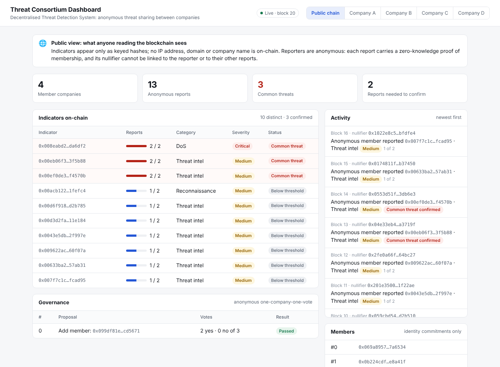
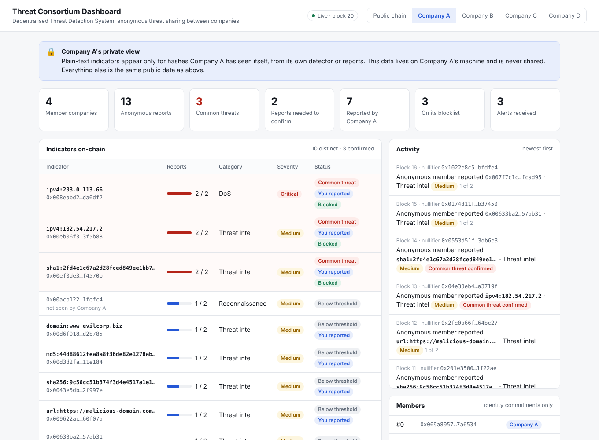
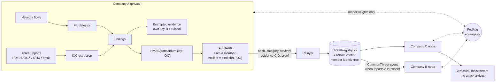

<div align="center">

# Decentralised Threat Detection System

**Companies detect attacks locally with machine learning, share what they saw anonymously, and warn each other before the same attack reaches them.**

[](https://github.com/Vinayak210405/Decentralised-Threat-Detection-System/actions/workflows/ci.yml)


</div>

## The idea

Many companies face the same cyber attacks every day, but they don't share what they see: a breach is embarrassing, reports contain internal details, and nobody wants a competitor reading their logs. So the same attacker hits company after company.

This project lets companies pool threat knowledge **without any of them being able to read the others' data**:

1. **Detect locally.** Each company runs an intrusion-detection model on its own traffic and extracts indicators (IPs, domains, file hashes) from the threat reports it receives. Raw data never leaves the company.
2. **Share anonymously.** For each indicator, the company submits only a *keyed hash* plus a **zero-knowledge proof** that says "a member company saw this", without revealing *which* member.
3. **Warn everyone when it's common.** When enough *independent* companies have reported the same indicator, the smart contract flags it as a common threat and every member blocks it, including members it hasn't hit yet.
4. **Learn together.** Companies can also train a shared detection model with **federated learning**: they exchange model weights, never traffic.

## Results

All numbers below were measured by the code in this repo; the commands to reproduce them are in [Reproduce](#reproduce).

### Intrusion detection (NSL-KDD, official test set)

| Model | Accuracy | Macro-F1 | Detection rate | False alarms | Detection: known attack types | Detection: **novel** attack types |
|---|---|---|---|---|---|---|
| Logistic regression | 76.3% | 58.6% | 70.1% | 9.3% | 81.6% | 42.2% |
| Random forest | 73.5% | 47.5% | 57.2% | 2.6% | 75.3% | 13.4% |
| **Gradient boosting** | **80.1%** | **66.5%** | 70.6% | 2.9% | **84.5%** | 37.0% |
| MLP (128-64) | 77.0% | 62.3% | 64.0% | 3.0% | 80.0% | 25.1% |

The NSL-KDD test set is deliberately hard: 16.6% of its rows are 17 attack types that never appear in training. The best single model catches **84.5% of attack types it was trained on but only 37% of novel ones**. That gap is the case for sharing between companies. Per-class tables and confusion matrices: [`reports/ml/nsl-kdd/results.md`](reports/ml/nsl-kdd/results.md).

### Intrusion detection (UNSW-NB15, official partitioned sets)

| Model | Accuracy | Macro-F1 | Detection rate | False alarms |
|---|---|---|---|---|
| Logistic regression | 62.1% | 35.8% | 99.3% | 42.3% |
| **Random forest** | **74.9%** | 48.3% | 97.0% | **23.2%** |
| Gradient boosting | 67.8% | **50.5%** | 99.6% | 40.2% |
| MLP (128-64) | 75.0% | 44.2% | 98.0% | 27.9% |

UNSW-NB15 is modern (2015) traffic with 9 attack families. Its official test set is known for normal traffic that differs from the training set, so every model over-alarms on normal flows; as attack-vs-normal, the random forest scores 87.9% accuracy, in line with published results on this split. The release names its two files the wrong way round; [`dtds/ml/datasets.py`](dtds/ml/datasets.py) follows the paper (train on the 175,341-row file) and verifies checksums. [`reports/ml/unsw-nb15/results.md`](reports/ml/unsw-nb15/results.md).

### Intrusion detection (CIC-IDS2017, 2.8 million flows)

| Model | Accuracy | Macro-F1 | Detection rate | False alarms |
|---|---|---|---|---|
| Logistic regression | 94.8% | 65.7% | 99.9% | 6.2% |
| Random forest | 99.8% | 95.8% | 99.4% | 0.1% |
| **Gradient boosting** | **99.8%** | **96.0%** | 99.8% | 0.2% |
| MLP (128-64) | 99.8% | 92.8% | 99.5% | 0.1% |

These are the usual near-perfect CIC-IDS2017 numbers, and they come from a random 80/20 split, which is known to be optimistic: 329,896 exact duplicate rows (12%) were removed first, and near-duplicates still land on both sides. The test that matters is below: with one attack family held out of training, the same classifier catches only **45%** of it at 2% false alarms. Loader details (checksum-verified download, cleaning steps, rare classes kept whole when sampling 600k rows): [`dtds/ml/datasets.py`](dtds/ml/datasets.py); results: [`reports/ml/cic-ids2017/results.md`](reports/ml/cic-ids2017/results.md).

### Catching attacks the model has never seen (`dtds/ml/novelty.py`)

A hybrid detector adds an **autoencoder trained only on normal traffic** to the classifier: whatever doesn't look normal raises its score, attack labels or not. Detectors are compared **at the same false-alarm rate**, because any detector catches more when allowed more false alarms.

| Novel-attack detection | at 2% false alarms | at 5% | at 10% |
|---|---|---|---|
| NSL-KDD, 17 unseen attack types: classifier alone | 5.3% | 71.0% | 75.5% |
| NSL-KDD: **hybrid** | 7.7% | **80.3%** | **82.9%** |
| UNSW-NB15, mean of 9 held-out families: classifier alone | 62.9% | **73.4%** | **82.6%** |
| UNSW-NB15: **hybrid** | **66.4%** | 70.5% | 77.7% |
| CIC-IDS2017, mean of 5 held-out families: classifier alone | 45.1% | 62.1% | 80.5% |
| CIC-IDS2017: **hybrid** | **57.8%** | **80.0%** | **88.7%** |

The honest summary: **the hybrid helps when a new attack looks unlike normal traffic and hurts when it imitates normal traffic.** On UNSW-NB15, held-out Generic attacks go from 2% to 99% detected and Exploits from 71% to 86%, but Reconnaissance drops from 75% to 25% and Shellcode from 27% to 1%. So it ships as an option, not the default. CIC-IDS2017 is the cleanest test, because the hybrid's design (the combination rule and the autoencoder) was fixed before that dataset was loaded: there it helps on 4 of 5 held-out families, most on DoS (31% to 77%). Two more findings came out of this:

* Most of the classifier's "37% on novel attacks" is its default threshold, not the model: allowed 5% false alarms instead of 2.8%, the same classifier catches 71%.
* Choices were made after looking at test results (the combination rule, then the autoencoder over an isolation forest, which was worse on UNSW-NB15), so every variant tried is published: [`novelty_autoencoder.md`](reports/ml/nsl-kdd/novelty_autoencoder.md), [`novelty_iforest.md`](reports/ml/nsl-kdd/novelty_iforest.md) for NSL-KDD and [the same two](reports/ml/unsw-nb15/) for UNSW-NB15.

### Reading real network traffic (Zeek)

[`dtds/ingest/`](dtds/ingest) turns a [Zeek](https://zeek.org) `conn.log`, the connection log of the most widely used open-source network sensor, into the flow features the detectors use. NSL-KDD's features were originally computed from Bro (Zeek's former name), so 26 of its 40 features can be rebuilt: the connection basics plus the 2-second and 255-connection window counts. The other 14 come from packet payloads and are dropped. Dropping them costs little except on password-guessing attacks:

| Gradient boosting on NSL-KDD | All 40 features | Network features only (26) |
|---|---|---|
| Accuracy | 80.1% | 78.9% |
| Macro-F1 | 66.5% | 61.9% |
| DoS recall | 78.8% | 81.1% |
| Probe recall | 79.2% | 80.5% |
| Remote-access (R2L) recall | 28.2% | 12.0% |

Run on the [synthetic sample logs](samples/zeek) (generated by `scripts/make_sample_conn_logs.py` from documented patterns, not real captures):

| Log | Classifier alone | Hybrid, calibrated on this network's baseline |
|---|---|---|
| Single-port SYN flood, 600 connections | 118 flagged | **600 flagged** |
| Port scan of 1,024 ports | 987 flagged | **1,024 flagged** |
| Normal traffic, false alarms | 5.4% | **2.5%** (target 2%) |

The classifier misses most of the flood because NSL-KDD's SYN floods spray many ports, while this one hits port 80 only: a shape it never trained on. The hybrid catches it, labelled `Unknown`. Calibrating on the company's own clean traffic (`--baseline`) matters: uncalibrated, the same hybrid false-alarms on 7.5% of normal flows because its idea of normal comes from a 1999 network. One weakness remains: the scan is categorised as DoS rather than reconnaissance.

```bash
python -m dtds.ingest samples/zeek/syn_flood.log --baseline samples/zeek/baseline.log
```

### Federated learning across 3 simulated companies (mean ± std over 5 seeds)

Each company sees normal traffic plus **only its own attack types** (A: DoS + probing, B: remote-access attacks, C: privilege escalation), the realistic case:

| | Macro-F1 | Attack detection rate | Recall on attack types the company never saw |
|---|---|---|---|
| Each company alone | 28.1 ± 0.6% | 23.2 ± 0.9% | 0% |
| **Federated (FedAvg, equal weight per company)** | **57.7 ± 2.4%** | **61.7 ± 0.7%** | **47.4 ± 0.7%** |
| Centralised (all data pooled; what privacy forbids) | 59.0 ± 4.4% | n/a | n/a |

Federated training gets within about 1 point of the pooled-data model without any company sharing a single flow. Standard sample-weighted FedAvg reaches 49.7%: the largest company drowns out rare attacks only smaller companies have seen, which equal per-company weighting fixes. Full table (including Dirichlet and IID splits): [`reports/ml/nsl-kdd/federated_summary.md`](reports/ml/nsl-kdd/federated_summary.md).

### Real traffic: Zeek logs from a cyber-defence competition

The detectors were run on **1,021,950 real connections** (21 minutes) from the 2018 Western Regional Collegiate Cyber Defense Competition, where a red team attacks student-defended networks ([Brim/Zed sample Zeek logs](https://github.com/brimdata/zed-sample-data), CC BY-SA 4.0, not redistributed). There are no labels, so sources are compared with a transparent behavioural proxy: a "likely scanner" hit 100+ distinct host/port pairs with most connections failing; a "likely benign" source hit at most 10 targets with 90%+ completed. That rule is not ground truth.

| On held-out sources | Scanner connections flagged | Benign connections flagged | Scanners reported | Benign sources reported |
|---|---|---|---|---|
| Classifier, report at 5 flagged connections | 53.9% | 1.7% | 16 / 16 | 4 / 15 |
| **Classifier, report at 5 flagged and 20% of its connections** | 53.9% | 1.7% | **13 / 16** | **0 / 15** |
| Hybrid, uncalibrated | 99.8% | 98.4% | 16 / 16 | 11 / 15 |
| Hybrid, calibrated on half the benign sources | 100% | 2.1% | 16 / 16 | 7-10 / 15 |

What real traffic taught, and what changed because of it:

* **Reporting by count alone breaks on busy machines.** Two benign servers made about 160,000 connections each; a 2% false-alarm rate still meant thousands of flagged connections. Nodes now also require that **20% of a source's connections** are flagged (`min_share`), which removed every benign report here at the cost of 3 of 16 scanners.
* **An uncalibrated anomaly detector is useless on a new network**: it flagged 97% of all traffic. Calibration fixes the connection-level rate (2.1%), but a baseline from a handful of sources, two of which dominate, is too narrow: many small benign sources still look unusual. On this network the classifier with the share rule is the better choice.

`python scripts/zeek_case_study.py conn.log` reproduces it; [`reports/zeek-wrccdc/case_study.md`](reports/zeek-wrccdc/case_study.md).

### Privacy for federated learning (`dtds/ml/private_fl.py`)

Model updates can leak training data, so federated training now has two protections:

* **Secure aggregation.** Each pair of companies agrees on a secret by X25519 key exchange and derives a ChaCha20 mask from it. One adds the mask, the other subtracts it, so the masks cancel exactly in the sum (fixed-point arithmetic mod 2^32). The aggregator learns only the total, never one company's update. Tested: the masked protocol trains the same model as plain FedAvg, and a single masked update has a correlation of under 0.05 with the real one.
* **Differential privacy.** Each update is clipped to norm 1, and each company adds its share of Gaussian noise, so no one ever sees an un-noised update. ε is computed with a Rényi-DP accountant over all 30 rounds (client-level, δ = 10⁻⁵).

| Macro-F1 (NSL-KDD, single seed) | No DP noise | ε ≈ 41 | ε ≈ 10 | ε ≈ 4.8 |
|---|---|---|---|---|
| 3 companies | 65.8% | 35.0% | 20.8% | 11.4% |
| 10 companies | 62.9% | 42.7% | 40.3% | 34.5% |
| 30 companies | 60.0% | 55.5% | 56.1% | 43.9% |
| **100 companies** | 57.7% | 55.0% | **54.5%** | **47.7%** |

**Strong privacy is only affordable with many participants.** The noise on the average shrinks as 1/(number of companies), so with 3 companies any meaningful ε destroys the model, while with 100 companies ε ≈ 10 costs about 3 points (false alarms 9.2% vs 7.2%). Secure aggregation alone has no accuracy cost. Not implemented: recovery when a company drops out mid-round (the full Bonawitz et al. protocol secret-shares the keys for that). [`reports/ml/nsl-kdd/private_fl.md`](reports/ml/nsl-kdd/private_fl.md).

### End-to-end demo (`python -m dtds.demo`, about 40 s)

A real local chain, real Groth16 proofs, the trained detector, and the team's sample threat reports:

* Companies A and B are hit by the same attacker; their detectors flag it and each reports it anonymously. Two independent reports reach the threshold, so the contract emits **CommonThreat**. A port scanner seen by only one company stays below the threshold.
* A and B ingest two *different* threat reports from `samples/reports/`; the two indicators both reports contain become common threats as well.
* Company C, never attacked yet, receives **3 early warnings**. The attacker then hits C with a DoS variant the model was never trained on:

| Company C | Attack flows stopped | Legitimate flows blocked |
|---|---|---|
| Its own ML classifier alone | 28 / 150 (19%) | n/a |
| Its own hybrid detector (classifier + autoencoder) | 128 / 150 (85%) | 19 / 400 (4.8%) false alarms |
| **With consortium early warning** | **150 / 150 (100%)** | **0** |

* Privacy check: no plaintext indicator is on-chain, an outsider's guess without the consortium key doesn't match, all 13 reports come from one relayer address, and company B cannot decrypt company A's evidence.
* Company D applies to join; A and B vote anonymously, and D is admitted.

Full transcript: [`docs/demo_output.txt`](docs/demo_output.txt). The 100% is by construction (the attacker reused an IP that was already flagged); see [Limitations](#threat-model-and-limitations) for what happens when attackers rotate infrastructure.

Proof generation takes about 1.5 s per report on a laptop CPU; `submitReport` costs about 310–340k gas.

## Dashboard

```bash
python -m dtds.demo          # saves a snapshot at the end
python -m dtds.dashboard     # open http://127.0.0.1:8050
```

For a live view, start the chain in its own terminal first (`npx hardhat node`, stop it with Ctrl+C), then run the demo and the dashboard in a second terminal: the demo reuses the running chain and leaves it up.

The dashboard puts the privacy design side by side. **Public chain** shows what anyone reading the blockchain sees: keyed hashes, anonymous reports with unlinkable nullifiers, common threats, governance votes. Switching to a **company's view** adds only what that company knows itself: plain-text indicators it saw, what it reported, its blocklist and its alerts, read from its own folder. Company C, never attacked, sees three blocked threats it has never seen in plain text.

| Public chain | Company A's private view |
|---|---|
|  |  |

It refreshes live against a running chain, falls back to the snapshot the demo saves, and `python -m dtds.dashboard --export dashboard.html` writes a single self-contained file. Every string from reports or the chain is HTML-escaped (tested with a planted script payload in Chrome), the server listens on 127.0.0.1 only, and it sends a strict Content-Security-Policy header.

## Architecture



| Component | Where | What it does |
|---|---|---|
| ML detection | [`dtds/ml/`](dtds/ml) | Dataset loaders (NSL-KDD, UNSW-NB15, CIC-IDS2017), signed-log + scaling + one-hot preprocessing, 4 classifiers, per-class and novel-attack evaluation |
| Zeek ingestion | [`dtds/ingest/`](dtds/ingest) | Reads Zeek `conn.log` (TSV or JSON), rebuilds 26 NSL-KDD features, network-only models, baseline calibration |
| Novel-attack detection | [`dtds/ml/novelty.py`](dtds/ml/novelty.py) | Hybrid classifier + anomaly detector (autoencoder, isolation forest or kNN) trained on normal traffic, evaluated at matched false-alarm rates and leave-one-family-out |
| Private federated learning | [`dtds/ml/private_fl.py`](dtds/ml/private_fl.py) | Secure aggregation (X25519 + ChaCha20 pairwise masks), clipping + distributed Gaussian noise, Rényi-DP accountant |
| Federated learning | [`dtds/ml/federated.py`](dtds/ml/federated.py) | FedAvg from scratch, federated feature scaling from aggregated statistics, non-IID partitions, class-balanced local loss |
| Report ingestion | [`dtds/extraction/`](dtds/extraction) | Text from PDF, DOCX, HTML, STIX/JSON, email, XLSX; refanging (`hxxp`, `[.]`), private/documentation IP filtering, benign allowlist, canonical IOC form |
| Keyed IOC hashing | [`dtds/sharing/ioc_hash.py`](dtds/sharing/ioc_hash.py) | HMAC-SHA256 under a consortium key, sized to the SNARK field |
| ZK membership circuit | [`circuits/membership.circom`](circuits/membership.circom) | Poseidon Merkle membership (depth 10, up to 1,024 companies) + nullifier + signal binding; 2,884 constraints |
| Smart contract | [`contracts/ThreatRegistry.sol`](contracts/ThreatRegistry.sol) | On-chain Poseidon member tree, proof verification, distinct-reporter counting, threshold alerts, anonymous governance |
| Company node | [`dtds/node.py`](dtds/node.py) | Detect, extract, hash, prove, submit; sync common threats; block on the watchlist |
| Alerts | [`dtds/alerts.py`](dtds/alerts.py) | Console, JSON-lines, webhook (Slack/Teams/Discord), email |

## How the privacy works

| Question | Answer |
|---|---|
| Can other companies see my traffic or reports? | No. They never leave your node. Only keyed hashes of indicators are shared. |
| Can someone reading the blockchain learn which IPs attacked us? | No. Indicators are HMAC'd with a key only members hold; a plain hash of an IPv4 address could be brute-forced in minutes, an HMAC cannot without the key. |
| Can anyone tell *which* company reported something? | No. The zk-SNARK proves "one of the members" without saying which. Reports go through a shared relayer, so the transaction sender is the same for everyone. Nullifiers are unlinkable across indicators. |
| Can one company fake a "common threat" by reporting many times? | No. The nullifier is `Poseidon(identity secret, indicator hash)`, the same every time that company reports that indicator, and the contract rejects reuse. Only *distinct* companies count. |
| Can a relayer or front-runner change my report's severity? | No. Category, severity and evidence pointer are hashed into the proof's public `signalHash`; changing them invalidates the proof (tested). |
| Can an outsider join? | Only by a majority vote of existing members, cast anonymously with the same membership proof (one company, one vote). |
| Can I prove later what I reported? | Yes. Each report points to an evidence bundle encrypted with *your own* key; the pointer is bound into the proof, so you can reveal it in an audit or dispute. |

## Threat model and limitations

This is a research prototype. It is honest about where its guarantees stop:

* **Members can test guesses.** Anyone holding the consortium key can check whether a *specific* indicator has been reported (that's how matching works). They still can't tell who reported it. Outsiders can't do either.
* **Attackers rotate infrastructure.** Blocking on a shared IP only works while the attacker reuses it. The federated model is the complementary defence: it generalises across attack *behaviour*, not addresses.
* **Single-party trusted setup.** The Groth16 phase-2 setup in `circuits/build/` was run by one machine. That's fine for a demo, but a real consortium must run a multi-party ceremony so no single party could forge proofs.
* **Relayer.** Anonymity on-chain requires submitting through a relayer (or fresh addresses). The demo uses one shared dev account to model this.
* **Federated learning privacy needs scale.** Secure aggregation and differential privacy are implemented, but meaningful ε only keeps the model useful with about 100 companies, and the secure-aggregation protocol doesn't survive a company dropping out mid-round.
* **Datasets.** NSL-KDD is old (1999-era traffic) but has an official split with novel attacks; UNSW-NB15 (2015) and CIC-IDS2017 are the modern checks. The federated-learning experiments have only been run on NSL-KDD. The CIC-IDS2017 models use CICFlowMeter features, so running them on live traffic would need CICFlowMeter rather than Zeek.
* **Real traffic without labels.** The only real-network test (WRCCDC) has no ground truth; its "scanner" and "benign" groups come from a behavioural rule.
* **Threshold choice.** A higher threshold resists colluding members but warns later. It is a governance parameter (changeable by vote).

## Reproduce

Requirements: **Python 3.10+**, **Node.js 22+** (Hardhat's runtime requires it; check with `node -v`). `circom` is only needed to rebuild the circuit; compiled artifacts are committed.

```bash
git clone https://github.com/Vinayak210405/Decentralised-Threat-Detection-System
cd Decentralised-Threat-Detection-System
npm install
pip install -r requirements.txt

npx hardhat test                 # 17 contract + ZK tests
python -m pytest -q              # 41 Python tests
python -m dtds.demo              # end-to-end demo (starts its own local chain)
```

Experiments (NSL-KDD downloads automatically, about 20 MB):

```bash
python -m dtds.ml.train --dataset nsl-kdd                                   # 4 models, ~1.5 min
python -m dtds.ml.federated --partition by-attack --aggregation uniform     # ~1.5 min
python scripts/fl_multiseed.py --seeds 1 2 3 4 5                            # ~25 min
python -m dtds.ml.private_fl --companies 3,10,30,100 --sigmas 0,1,3,6      # ~20 min
python -m dtds.ml.train --dataset unsw-nb15                                 # downloads ~47 MB, checksum-verified
python -m dtds.ml.novelty --dataset nsl-kdd                                 # hybrid detector, ~4 min
python -m dtds.ml.novelty --dataset unsw-nb15                               # leave-one-family-out, ~25 min
python -m dtds.extraction samples/reports/cisa_aa22-320a_iranian_apt.pdf    # IOC extraction
python -m dtds.ingest samples/zeek/syn_flood.log --baseline samples/zeek/baseline.log   # Zeek log -> findings
```

CIC-IDS2017 downloads automatically the first time (about 880 MB, checksum-verified; loading needs about 4 GB of RAM): `python -m dtds.ml.train --dataset cic-ids2017`.

Rebuild the circuit and verifier (needs `circom` 2.1.x on PATH): `npm run zk:build`.

Optional integrations, all configured via environment variables (see `.env.example`): an IPFS daemon for evidence storage, a webhook or SMTP server for alerts, and a private key and RPC URL to deploy on a testnet.

## Repository layout

```
dtds/                 Python package
  ml/                 datasets, preprocessing, models, evaluation, federated learning
  extraction/         threat-report parsing and IOC extraction
  sharing/            keyed hashing, evidence encryption, ZK prover bridge, chain client
  node.py             a company's node
  alerts.py           alert channels
  demo.py             end-to-end demo
circuits/             Circom circuit + compiled artifacts (build/)
contracts/            ThreatRegistry.sol, generated Groth16Verifier.sol
scripts/              ZK library and CLI, deployment, multi-seed experiments
test/                 Hardhat (JavaScript) tests
tests/                pytest tests
reports/ml/           committed experiment results
samples/reports/      sample threat reports (incl. a real CISA advisory)
docs/                 demo transcript
legacy/v1/            the original 2025 prototype, kept for reference
```

## History

v1 (2025) was built as an ELC team project and explored the same idea with a regex/spaCy extractor, IPFS storage and a first Circom/Solidity prototype; its code is preserved in [`legacy/v1/`](legacy/v1). v2 rebuilt the system around a concrete privacy design (keyed hashes, membership proofs with nullifiers, threshold alerts), added the ML detection and federated learning components, and added tests and CI.
