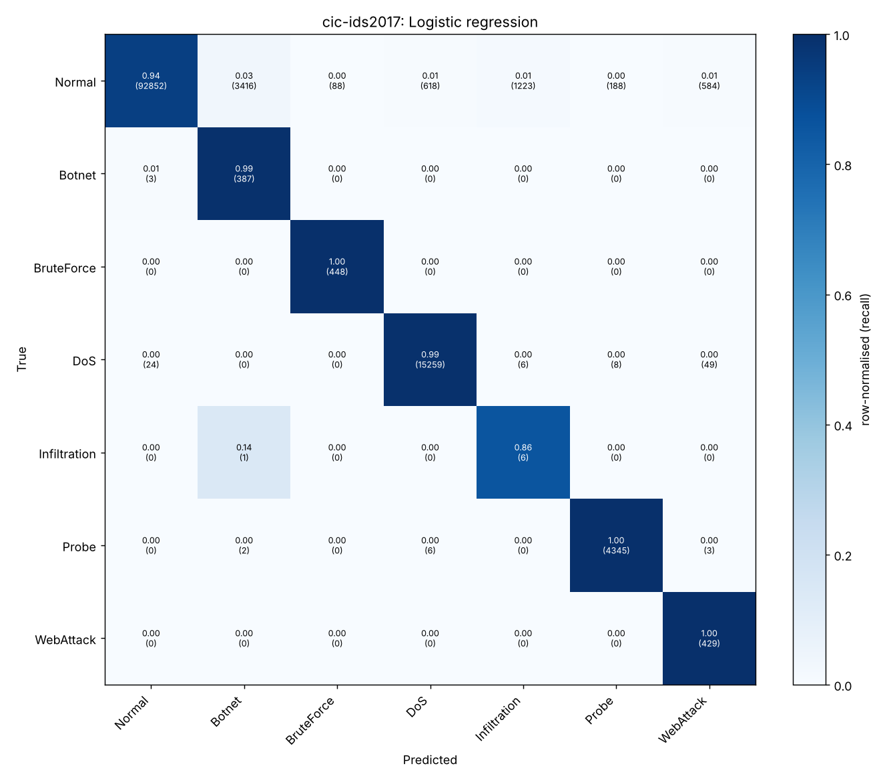
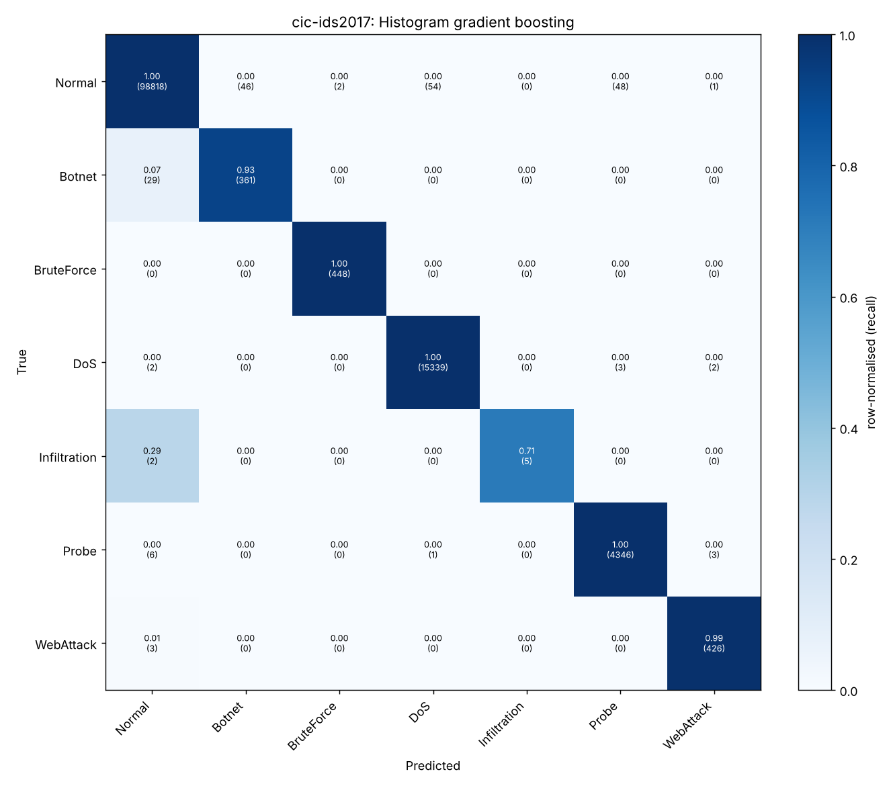
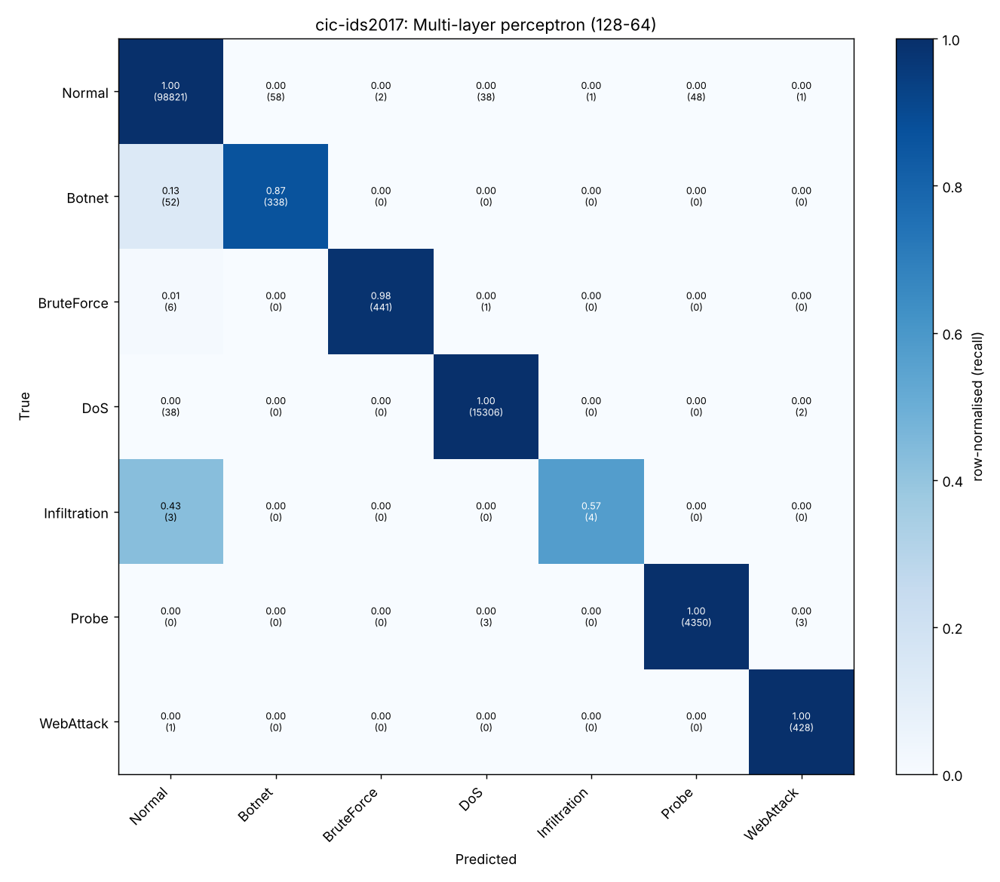

# Results: cic-ids2017

Train rows: 479,779, test rows: 119,945, features: 69.

- 8 CSV files, 2,830,743 rows; 2,867 rows with NaN/inf dropped, 329,896 exact duplicate rows removed, 8 constant and 1 duplicated columns dropped
- no official split: stratified 80/20 split after de-duplication
- sample of 599,724 rows: classes under 5,000 rows kept whole, the rest sampled uniformly (pass max_rows=None for all)

## Summary

| Model | Accuracy | Macro-F1 | Detection rate | False-alarm rate | Train time | Inference per 1k flows |
|---|---|---|---|---|---|---|
| Logistic regression, class-balanced (linear baseline) | 94.8% | 65.7% | 99.9% | 6.2% | 39.9s | 1.2 ms |
| Random forest, 200 trees, balanced class weights per bootstrap | 99.8% | 95.8% | 99.4% | 0.1% | 233.3s | 20.0 ms |
| Histogram gradient boosting, balanced class weights | 99.8% | 96.0% | 99.8% | 0.2% | 42.1s | 24.3 ms |
| Multi-layer perceptron (128-64), Adam, early stopping | 99.8% | 92.8% | 99.5% | 0.1% | 128.0s | 7.3 ms |

## Logistic regression, class-balanced (linear baseline)

| Class | Precision | Recall | F1 | Support |
|---|---|---|---|---|
| Normal | 100.0% | 93.8% | 96.8% | 98,969 |
| Botnet | 10.2% | 99.2% | 18.4% | 390 |
| BruteForce | 83.6% | 100.0% | 91.1% | 448 |
| DoS | 96.1% | 99.4% | 97.7% | 15,346 |
| Infiltration | 0.5% | 85.7% | 1.0% | 7 |
| Probe | 95.7% | 99.7% | 97.7% | 4,356 |
| WebAttack | 40.3% | 100.0% | 57.4% | 429 |

## Random forest, 200 trees, balanced class weights per bootstrap

| Class | Precision | Recall | F1 | Support |
|---|---|---|---|---|
| Normal | 99.9% | 99.9% | 99.9% | 98,969 |
| Botnet | 92.2% | 87.7% | 89.9% | 390 |
| BruteForce | 100.0% | 99.6% | 99.8% | 448 |
| DoS | 99.9% | 99.8% | 99.8% | 15,346 |
| Infiltration | 100.0% | 71.4% | 83.3% | 7 |
| Probe | 99.0% | 98.9% | 98.9% | 4,356 |
| WebAttack | 98.8% | 99.1% | 99.0% | 429 |

## Histogram gradient boosting, balanced class weights

| Class | Precision | Recall | F1 | Support |
|---|---|---|---|---|
| Normal | 100.0% | 99.8% | 99.9% | 98,969 |
| Botnet | 88.7% | 92.6% | 90.6% | 390 |
| BruteForce | 99.6% | 100.0% | 99.8% | 448 |
| DoS | 99.6% | 100.0% | 99.8% | 15,346 |
| Infiltration | 100.0% | 71.4% | 83.3% | 7 |
| Probe | 98.8% | 99.8% | 99.3% | 4,356 |
| WebAttack | 98.6% | 99.3% | 99.0% | 429 |

## Multi-layer perceptron (128-64), Adam, early stopping

| Class | Precision | Recall | F1 | Support |
|---|---|---|---|---|
| Normal | 99.9% | 99.9% | 99.9% | 98,969 |
| Botnet | 85.4% | 86.7% | 86.0% | 390 |
| BruteForce | 99.5% | 98.4% | 99.0% | 448 |
| DoS | 99.7% | 99.7% | 99.7% | 15,346 |
| Infiltration | 80.0% | 57.1% | 66.7% | 7 |
| Probe | 98.9% | 99.9% | 99.4% | 4,356 |
| WebAttack | 98.6% | 99.8% | 99.2% | 429 |

