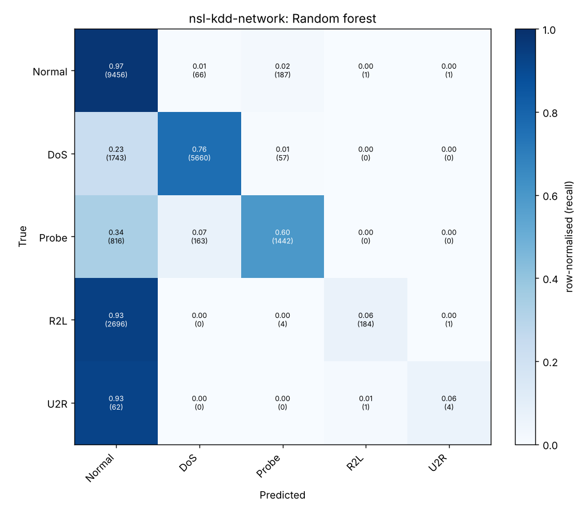
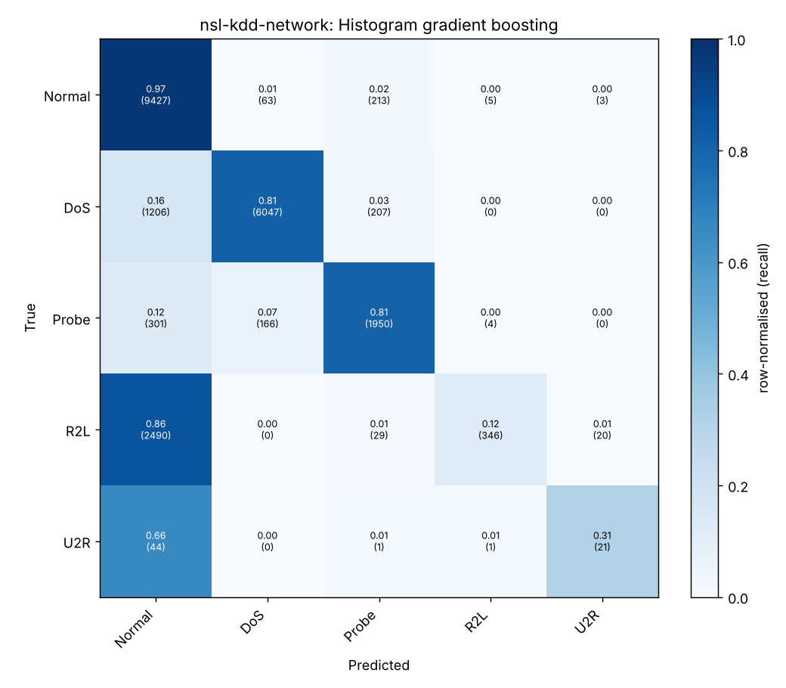

# Results: nsl-kdd-network

Train rows: 125,973, test rows: 22,544, features: 26.

- official KDDTest+ split; 3750 test rows (16.6%) are 17 attack types never seen in training: apache2, httptunnel, mailbomb, mscan, named, processtable, ps, saint, sendmail, snmpgetattack, snmpguess, sqlattack, udpstorm, worm, xlock, xsnoop, xterm
- network-only: 26 features a Zeek conn.log can provide; payload and packet-level features removed

## Summary

| Model | Accuracy | Macro-F1 | Detection rate | False-alarm rate | Detection (known attacks) | Detection (novel attacks) | Train time | Inference per 1k flows |
|---|---|---|---|---|---|---|---|---|
| Random forest, 200 trees, balanced class weights per bootstrap | 74.3% | 51.0% | 58.6% | 2.6% | 77.2% | 13.5% | 10.0s | 11.2 ms |
| Histogram gradient boosting, balanced class weights | 78.9% | 61.9% | 68.5% | 2.9% | 79.3% | 42.5% | 9.5s | 9.4 ms |

## Random forest, 200 trees, balanced class weights per bootstrap

| Class | Precision | Recall | F1 | Support |
|---|---|---|---|---|
| Normal | 64.0% | 97.4% | 77.2% | 9,711 |
| DoS | 96.1% | 75.9% | 84.8% | 7,460 |
| Probe | 85.3% | 59.6% | 70.2% | 2,421 |
| R2L | 98.9% | 6.4% | 12.0% | 2,885 |
| U2R | 66.7% | 6.0% | 11.0% | 67 |

## Histogram gradient boosting, balanced class weights

| Class | Precision | Recall | F1 | Support |
|---|---|---|---|---|
| Normal | 70.0% | 97.1% | 81.3% | 9,711 |
| DoS | 96.4% | 81.1% | 88.0% | 7,460 |
| Probe | 81.2% | 80.5% | 80.9% | 2,421 |
| R2L | 97.2% | 12.0% | 21.4% | 2,885 |
| U2R | 47.7% | 31.3% | 37.8% | 67 |

