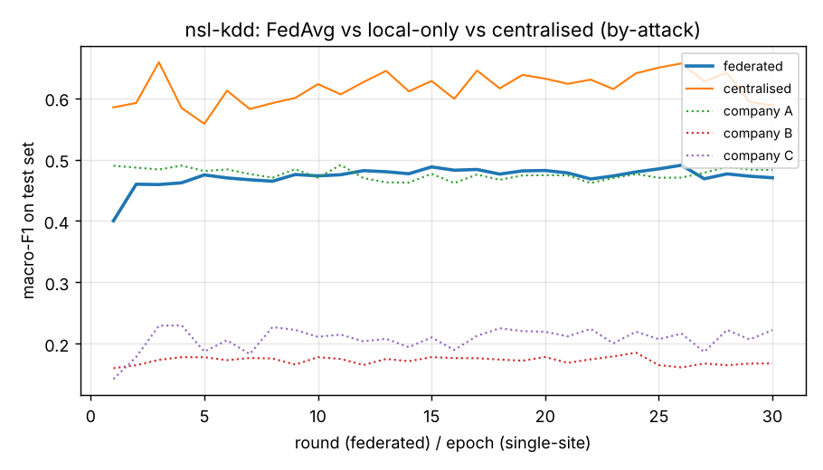

# Federated learning: nsl-kdd, partition = by-attack (plain loss, no class weighting)

3 simulated companies, 30 rounds x 1 local epoch(s). Model: MLP 128-64 (sklearn MLPClassifier, Adam), FedAvg weighted by sample count. Local-only and centralised models get the same number of epochs.

## What each company saw

| Company | Training data |
|---|---|
| company_A | DoS: 45,927, Normal: 22,448, Probe: 11,656 |
| company_B | Normal: 22,448, R2L: 995 |
| company_C | Normal: 22,447, U2R: 52 |

## Results on the full test set

| Setting | Accuracy | Macro-F1 | Detection rate | False-alarm rate | Detection (novel attacks) |
|---|---|---|---|---|---|
| centralised | 78.2% | 58.8% | 65.9% | 3.0% | 32.2% |
| federated | 74.9% | 47.0% | 60.8% | 2.8% | 24.3% |
| local company A | 76.3% | 48.3% | 63.3% | 3.0% | 32.7% |
| local company B | 44.8% | 16.8% | 3.7% | 0.0% | 0.4% |
| local company C | 43.2% | 22.2% | 0.3% | 0.1% | 0.3% |

## Recall on attack categories a company never saw locally

| Company | Never saw | Local-only recall | Federated recall |
|---|---|---|---|
| company_A | R2L, U2R | 0.0% | 0.4% |
| company_B | DoS, Probe, U2R | 0.0% | 74.7% |
| company_C | DoS, Probe, R2L | 0.0% | 58.3% |

