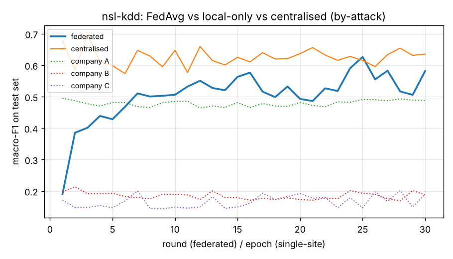

# Federated learning: nsl-kdd, partition = by-attack

3 simulated companies, 30 rounds x 1 local epoch(s). Model: MLP 128-64 (sklearn MLPClassifier, Adam), FedAvg weighted by sample count; class-balanced local loss: yes; aggregation weights: uniform. Local-only and centralised models get the same number of epochs.

## What each company saw

| Company | Training data |
|---|---|
| company_A | DoS: 45,927, Normal: 22,448, Probe: 11,656 |
| company_B | Normal: 22,448, R2L: 995 |
| company_C | Normal: 22,447, U2R: 52 |

## Results on the full test set

| Setting | Accuracy | Macro-F1 | Detection rate | False-alarm rate | Detection (novel attacks) |
|---|---|---|---|---|---|
| centralised | 77.4% | 63.5% | 65.0% | 3.6% | 27.8% |
| federated | 74.8% | 58.2% | 59.1% | 2.6% | 18.2% |
| local company A | 76.9% | 48.8% | 64.4% | 3.0% | 37.8% |
| local company B | 45.6% | 18.7% | 5.8% | 0.1% | 2.2% |
| local company C | 43.2% | 19.0% | 0.7% | 0.1% | 0.5% |

## Recall on attack categories a company never saw locally

| Company | Never saw | Local-only recall | Federated recall |
|---|---|---|---|
| company_A | R2L, U2R | 0.0% | 8.0% |
| company_B | DoS, Probe, U2R | 0.0% | 72.1% |
| company_C | DoS, Probe, R2L | 0.0% | 57.8% |

