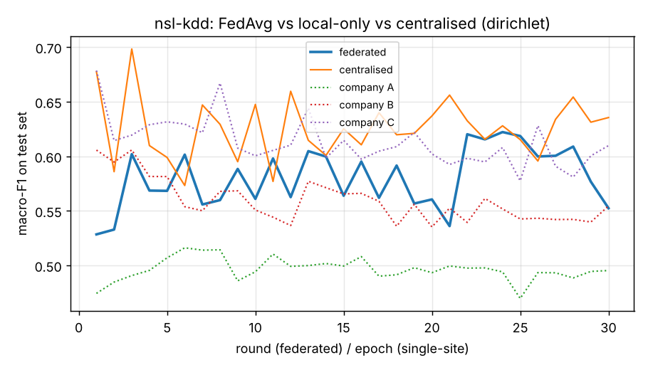

# Federated learning: nsl-kdd, partition = dirichlet (alpha=0.3)

3 simulated companies, 30 rounds x 1 local epoch(s). Model: MLP 128-64 (sklearn MLPClassifier, Adam), FedAvg weighted by sample count; class-balanced local loss: yes; aggregation weights: samples. Local-only and centralised models get the same number of epochs.

## What each company saw

| Company | Training data |
|---|---|
| company_A | DoS: 44,294, Probe: 2,746, Normal: 1,833, R2L: 7 |
| company_B | Normal: 53,602, Probe: 6,305, DoS: 853, R2L: 683, U2R: 1 |
| company_C | Normal: 11,908, Probe: 2,605, DoS: 780, R2L: 305, U2R: 51 |

## Results on the full test set

| Setting | Accuracy | Macro-F1 | Detection rate | False-alarm rate | Detection (novel attacks) |
|---|---|---|---|---|---|
| centralised | 77.4% | 63.5% | 65.0% | 3.6% | 27.8% |
| federated | 78.2% | 55.2% | 67.0% | 3.6% | 34.9% |
| local company A | 75.7% | 49.5% | 67.6% | 7.8% | 37.1% |
| local company B | 78.8% | 55.4% | 67.2% | 3.1% | 32.7% |
| local company C | 77.9% | 61.0% | 65.4% | 2.7% | 28.3% |

## Recall on attack categories a company never saw locally

| Company | Never saw | Local-only recall | Federated recall |
|---|---|---|---|
| company_A | U2R | 0.0% | 4.5% |

