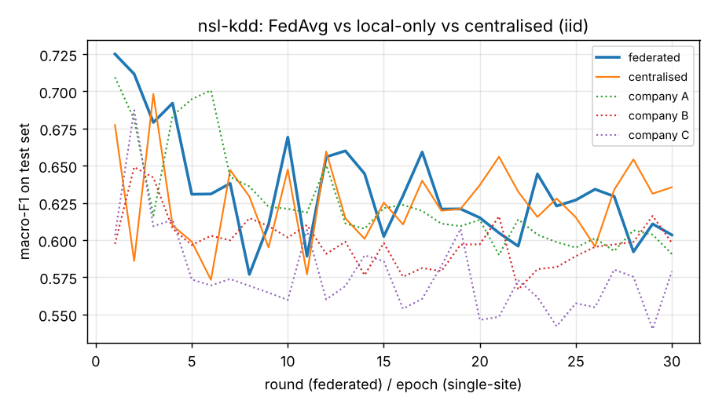

# Federated learning: nsl-kdd, partition = iid

3 simulated companies, 30 rounds x 1 local epoch(s). Model: MLP 128-64 (sklearn MLPClassifier, Adam), FedAvg weighted by sample count; class-balanced local loss: yes; aggregation weights: samples. Local-only and centralised models get the same number of epochs.

## What each company saw

| Company | Training data |
|---|---|
| company_A | Normal: 22,545, DoS: 15,228, Probe: 3,860, R2L: 339, U2R: 19 |
| company_B | Normal: 22,294, DoS: 15,380, Probe: 3,964, R2L: 339, U2R: 14 |
| company_C | Normal: 22,504, DoS: 15,319, Probe: 3,832, R2L: 317, U2R: 19 |

## Results on the full test set

| Setting | Accuracy | Macro-F1 | Detection rate | False-alarm rate | Detection (novel attacks) |
|---|---|---|---|---|---|
| centralised | 77.4% | 63.5% | 65.0% | 3.6% | 27.8% |
| federated | 77.8% | 60.3% | 71.5% | 7.7% | 30.3% |
| local company A | 75.4% | 59.1% | 64.7% | 7.8% | 28.5% |
| local company B | 76.7% | 59.8% | 67.0% | 7.4% | 27.9% |
| local company C | 76.9% | 57.9% | 64.9% | 3.0% | 28.6% |

