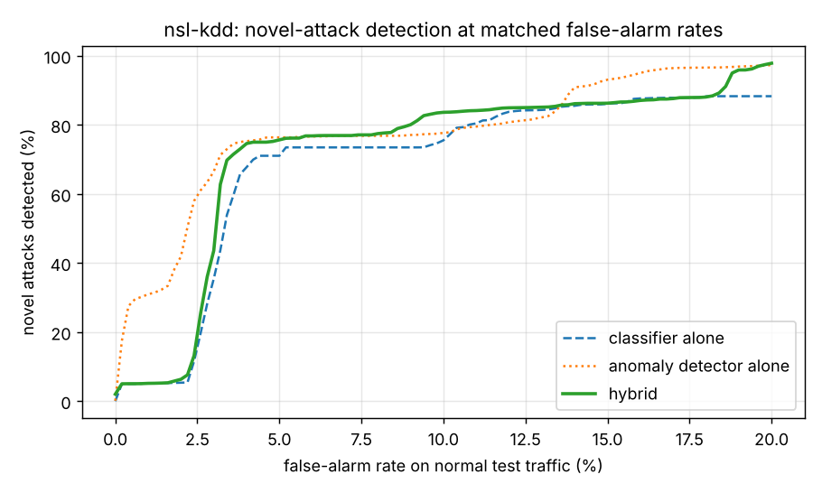

# Detecting novel attacks: nsl-kdd (iforest)

Hybrid = gradient-boosting classifier + isolation forest (200 trees) trained on normal traffic only. Novel attacks: 17 attack types present only in the official test set (3750 rows).

## Detection of novel attacks at the same false-alarm rate

| Detector | at 1% false alarms | at 2% false alarms | at 5% false alarms | at 10% false alarms | AUC |
|---|---|---|---|---|---|
| Classifier alone | 5.2% | 5.3% | 71.0% | 75.5% | 0.881 |
| Anomaly detector alone | 30.9% | 41.9% | 76.4% | 77.7% | 0.953 |
| **Hybrid** | 5.1% | 6.3% | 75.7% | 83.6% | 0.944 |

Known attack types at the same false-alarm rates:

| Detector | at 1% | at 2% | at 5% | at 10% |
|---|---|---|---|---|
| Classifier alone | 55.3% | 70.8% | 90.7% | 91.2% |
| Hybrid | 54.3% | 69.2% | 89.2% | 90.8% |

## Deployable operating point

Thresholds set on held-out *training* normals for a 2.0% false-alarm target, then measured on the test set:

| | False alarms (test) | Novel attacks detected | Known attacks detected |
|---|---|---|---|
| Classifier alone (default threshold) | 2.8% | 32.0% | |
| Hybrid | 4.1% | 74.8% | 89.1% |

42.8% of novel attack flows were labelled `Unknown` (flagged by the anomaly detector only).

## Combination rules tried

The default was chosen after looking at this test set (and a synthetic case where a plain sum failed), so every rule tried is listed; UNSW-NB15 (leave-one-family-out) is the independent check.

| Rule | Novel @2% | Novel @5% | Novel @10% | Known @2% | Known @5% | AUC novel | AUC known |
|---|---|---|---|---|---|---|---|
| classifier only | 5.3% | 71.0% | 75.5% | 70.8% | 90.7% | 0.881 | 0.977 |
| anomaly only | 41.9% | 76.4% | 77.7% | 62.3% | 77.6% | 0.953 | 0.944 |
| max(classifier, anomaly) | 5.3% | 72.1% | 77.0% | 70.8% | 90.7% | 0.940 | 0.975 |
| sum | 6.3% | 75.7% | 83.6% | 69.2% | 89.2% | 0.938 | 0.974 |
| 0.3 x classifier + anomaly | 11.1% | 78.2% | 83.5% | 65.3% | 86.0% | 0.946 | 0.967 |
| anomaly + max(classifier, 0) (default) | 6.3% | 75.7% | 83.6% | 69.2% | 89.2% | 0.944 | 0.973 |

2.3% of normal test flows get a classifier attack probability above 0.999, so below that false-alarm rate no rule that uses the classifier can do much.

## Anomaly scorers compared

| Scorer | AUC: normal vs novel attacks | AUC: normal vs all attacks | Fit + score time |
|---|---|---|---|
| k-nearest-neighbour distance to normal traffic (k=5) | 0.935 | 0.966 | 3.2s |
| autoencoder reconstruction error (64-16-64) | 0.948 | 0.962 | 1.5s |
| isolation forest (200 trees) | 0.953 | 0.947 | 0.7s |

