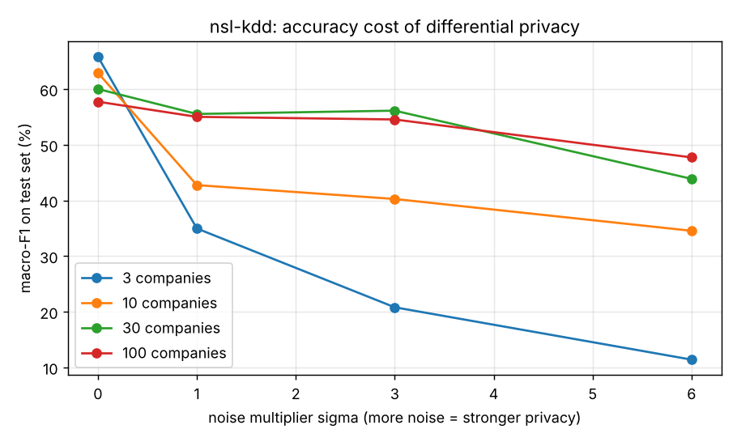

# Private federated learning: nsl-kdd

Secure aggregation (X25519 + ChaCha20 pairwise masks) in every run; differential privacy by clipping each company's update to norm 1.0 and adding distributed Gaussian noise. 30 rounds, companies split by Dirichlet(alpha=0.5) label skew, epsilon at delta = 1e-05 (client-level, Renyi-DP accountant).

## Macro-F1 by number of companies and privacy level

| Noise multiplier | Epsilon | 3 companies | 10 companies | 30 companies | 100 companies |
|---|---|---|---|---|---|
| 0 | none (no noise) | 65.8% | 62.9% | 60.0% | 57.7% |
| 1 | 41.3 | 35.0% | 42.7% | 55.5% | 55.0% |
| 3 | 10.4 | 20.8% | 40.3% | 56.1% | 54.5% |
| 6 | 4.8 | 11.4% | 34.5% | 43.9% | 47.7% |

## Attack detection rate / false-alarm rate

| Noise multiplier | 3 companies | 10 companies | 30 companies | 100 companies |
|---|---|---|---|---|
| 0 | 68.0% / 3.6% | 65.4% / 3.0% | 64.4% / 7.5% | 65.2% / 7.2% |
| 1 | 83.3% / 40.2% | 42.0% / 3.7% | 71.1% / 9.4% | 64.7% / 7.7% |
| 3 | 90.8% / 77.9% | 48.8% / 7.6% | 89.7% / 21.0% | 69.9% / 9.2% |
| 6 | 90.2% / 92.9% | 84.6% / 23.6% | 94.8% / 56.9% | 64.3% / 7.9% |

Updates clipped: 55% on average (median update norm before clipping 1.07).

