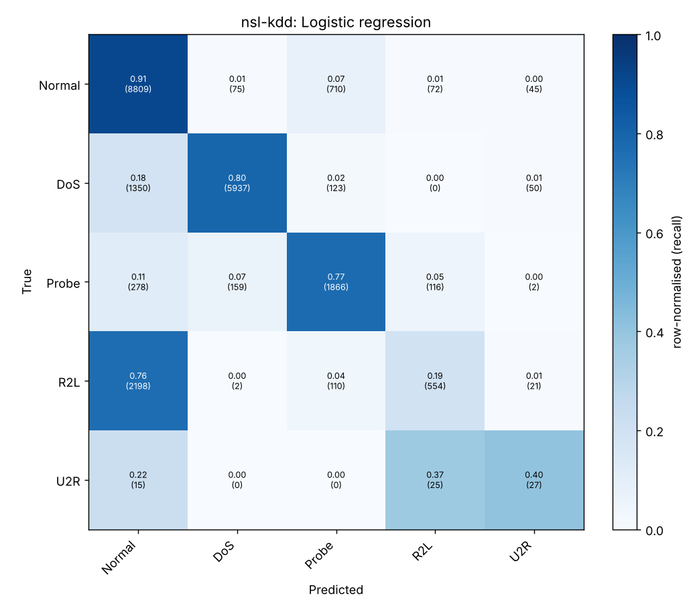
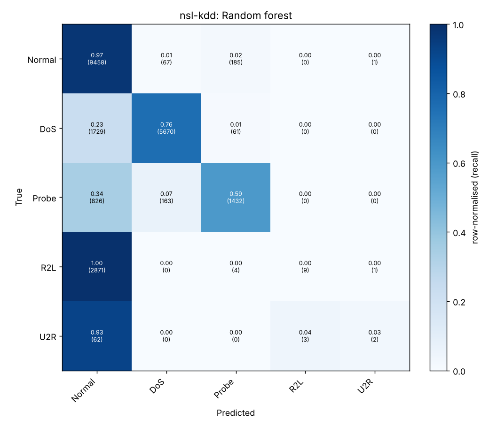
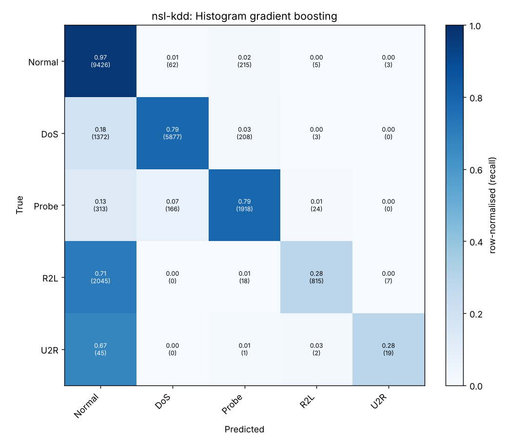
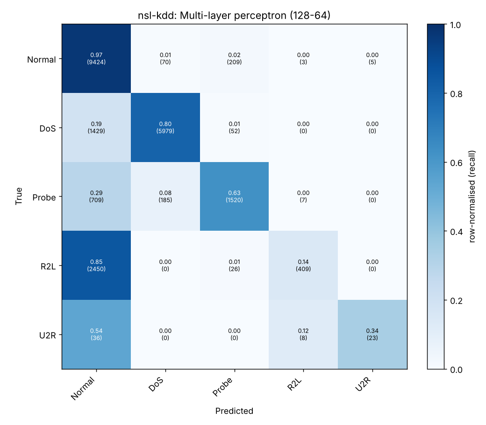

# Results: nsl-kdd

Train rows: 125,973, test rows: 22,544, features: 40.

- official KDDTest+ split; 3750 test rows (16.6%) are 17 attack types never seen in training: apache2, httptunnel, mailbomb, mscan, named, processtable, ps, saint, sendmail, snmpgetattack, snmpguess, sqlattack, udpstorm, worm, xlock, xsnoop, xterm

## Summary

| Model | Accuracy | Macro-F1 | Detection rate | False-alarm rate | Detection (known attacks) | Detection (novel attacks) | Train time | Inference per 1k flows |
|---|---|---|---|---|---|---|---|---|
| Logistic regression, class-balanced (linear baseline) | 76.3% | 58.6% | 70.1% | 9.3% | 81.6% | 42.2% | 33.9s | 2.0 ms |
| Random forest, 200 trees, balanced class weights per bootstrap | 73.5% | 47.5% | 57.2% | 2.6% | 75.3% | 13.4% | 10.4s | 10.9 ms |
| Histogram gradient boosting, balanced class weights | 80.1% | 66.5% | 70.6% | 2.9% | 84.5% | 37.0% | 9.0s | 7.3 ms |
| Multi-layer perceptron (128-64), Adam, early stopping | 77.0% | 62.3% | 64.0% | 3.0% | 80.0% | 25.1% | 21.7s | 4.0 ms |

## Logistic regression, class-balanced (linear baseline)

| Class | Precision | Recall | F1 | Support |
|---|---|---|---|---|
| Normal | 69.6% | 90.7% | 78.8% | 9,711 |
| DoS | 96.2% | 79.6% | 87.1% | 7,460 |
| Probe | 66.4% | 77.1% | 71.4% | 2,421 |
| R2L | 72.2% | 19.2% | 30.3% | 2,885 |
| U2R | 18.6% | 40.3% | 25.5% | 67 |

## Random forest, 200 trees, balanced class weights per bootstrap

| Class | Precision | Recall | F1 | Support |
|---|---|---|---|---|
| Normal | 63.3% | 97.4% | 76.7% | 9,711 |
| DoS | 96.1% | 76.0% | 84.9% | 7,460 |
| Probe | 85.1% | 59.1% | 69.8% | 2,421 |
| R2L | 75.0% | 0.3% | 0.6% | 2,885 |
| U2R | 50.0% | 3.0% | 5.6% | 67 |

## Histogram gradient boosting, balanced class weights

| Class | Precision | Recall | F1 | Support |
|---|---|---|---|---|
| Normal | 71.4% | 97.1% | 82.3% | 9,711 |
| DoS | 96.3% | 78.8% | 86.6% | 7,460 |
| Probe | 81.3% | 79.2% | 80.2% | 2,421 |
| R2L | 96.0% | 28.2% | 43.7% | 2,885 |
| U2R | 65.5% | 28.4% | 39.6% | 67 |

## Multi-layer perceptron (128-64), Adam, early stopping

| Class | Precision | Recall | F1 | Support |
|---|---|---|---|---|
| Normal | 67.1% | 97.0% | 79.3% | 9,711 |
| DoS | 95.9% | 80.1% | 87.3% | 7,460 |
| Probe | 84.1% | 62.8% | 71.9% | 2,421 |
| R2L | 95.8% | 14.2% | 24.7% | 2,885 |
| U2R | 82.1% | 34.3% | 48.4% | 67 |

