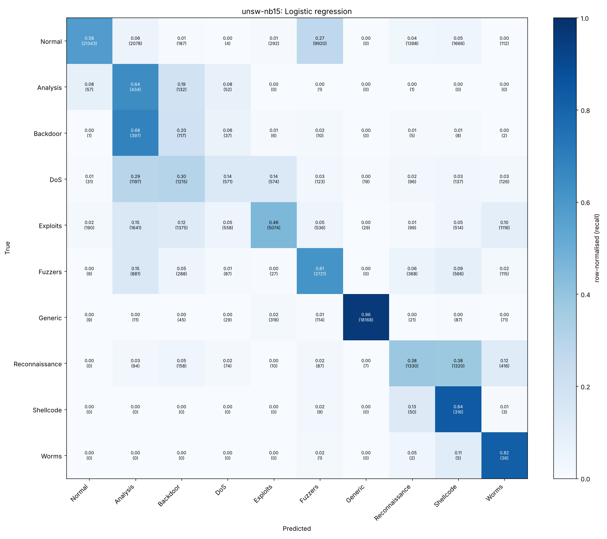
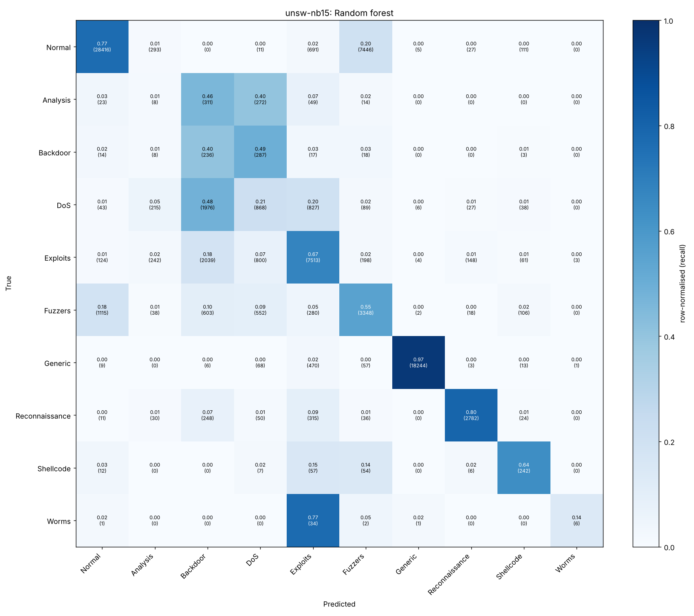
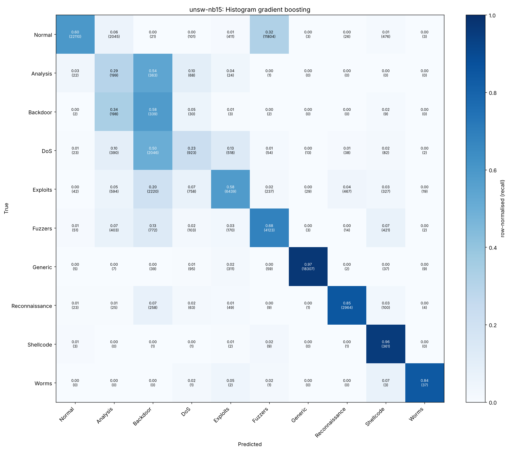
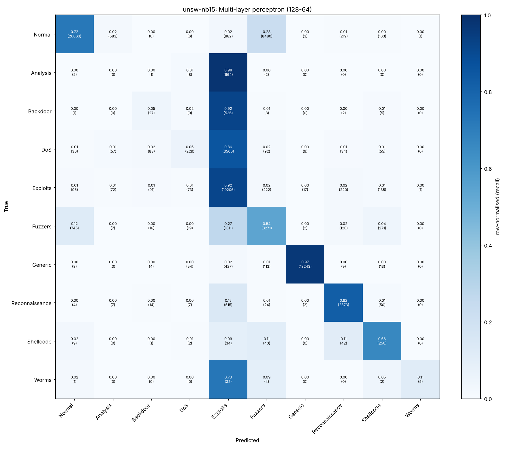

# Results: unsw-nb15

Train rows: 175,341, test rows: 82,332, features: 42.

- official partitioned sets, following the paper: the 175,341-row file is used for training (the release names the files the other way round)

## Summary

| Model | Accuracy | Macro-F1 | Detection rate | False-alarm rate | Train time | Inference per 1k flows |
|---|---|---|---|---|---|---|
| Logistic regression, class-balanced (linear baseline) | 62.1% | 35.8% | 99.3% | 42.3% | 108.4s | 2.1 ms |
| Random forest, 200 trees, balanced class weights per bootstrap | 74.9% | 48.3% | 97.0% | 23.2% | 56.1s | 35.9 ms |
| Histogram gradient boosting, balanced class weights | 67.8% | 50.5% | 99.6% | 40.2% | 241.9s | 129.1 ms |
| Multi-layer perceptron (128-64), Adam, early stopping | 75.0% | 44.2% | 98.0% | 27.9% | 58.3s | 4.8 ms |

## Logistic regression, class-balanced (linear baseline)

| Class | Precision | Recall | F1 | Support |
|---|---|---|---|---|
| Normal | 98.6% | 57.7% | 72.8% | 37,000 |
| Analysis | 6.4% | 64.1% | 11.7% | 677 |
| Backdoor | 3.3% | 20.1% | 5.7% | 583 |
| DoS | 40.4% | 14.0% | 20.8% | 4,089 |
| Exploits | 80.6% | 45.6% | 58.2% | 11,132 |
| Fuzzers | 25.6% | 61.4% | 36.2% | 6,062 |
| Generic | 99.7% | 96.3% | 98.0% | 18,871 |
| Reconnaissance | 39.5% | 38.0% | 38.7% | 3,496 |
| Shellcode | 6.8% | 83.6% | 12.6% | 378 |
| Worms | 1.8% | 81.8% | 3.5% | 44 |

## Random forest, 200 trees, balanced class weights per bootstrap

| Class | Precision | Recall | F1 | Support |
|---|---|---|---|---|
| Normal | 95.5% | 76.8% | 85.1% | 37,000 |
| Analysis | 1.0% | 1.2% | 1.1% | 677 |
| Backdoor | 4.4% | 40.5% | 7.9% | 583 |
| DoS | 29.8% | 21.2% | 24.8% | 4,089 |
| Exploits | 73.3% | 67.5% | 70.3% | 11,132 |
| Fuzzers | 29.7% | 55.2% | 38.7% | 6,062 |
| Generic | 99.9% | 96.7% | 98.3% | 18,871 |
| Reconnaissance | 92.4% | 79.6% | 85.5% | 3,496 |
| Shellcode | 40.5% | 64.0% | 49.6% | 378 |
| Worms | 60.0% | 13.6% | 22.2% | 44 |

## Histogram gradient boosting, balanced class weights

| Class | Precision | Recall | F1 | Support |
|---|---|---|---|---|
| Normal | 99.2% | 59.8% | 74.6% | 37,000 |
| Analysis | 5.2% | 29.4% | 8.8% | 677 |
| Backdoor | 5.6% | 58.1% | 10.2% | 583 |
| DoS | 43.1% | 22.6% | 29.6% | 4,089 |
| Exploits | 81.2% | 57.8% | 67.6% | 11,132 |
| Fuzzers | 25.3% | 68.0% | 36.9% | 6,062 |
| Generic | 99.7% | 97.0% | 98.4% | 18,871 |
| Reconnaissance | 84.4% | 84.8% | 84.6% | 3,496 |
| Shellcode | 19.9% | 95.5% | 32.9% | 378 |
| Worms | 48.7% | 84.1% | 61.7% | 44 |

## Multi-layer perceptron (128-64), Adam, early stopping

| Class | Precision | Recall | F1 | Support |
|---|---|---|---|---|
| Normal | 96.8% | 72.1% | 82.6% | 37,000 |
| Analysis | 0.0% | 0.0% | 0.0% | 677 |
| Backdoor | 11.4% | 4.6% | 6.6% | 583 |
| DoS | 56.3% | 5.6% | 10.2% | 4,089 |
| Exploits | 55.4% | 91.7% | 69.1% | 11,132 |
| Fuzzers | 26.7% | 54.0% | 35.7% | 6,062 |
| Generic | 99.8% | 96.7% | 98.2% | 18,871 |
| Reconnaissance | 81.6% | 82.2% | 81.9% | 3,496 |
| Shellcode | 26.5% | 66.1% | 37.8% | 378 |
| Worms | 71.4% | 11.4% | 19.6% | 44 |

